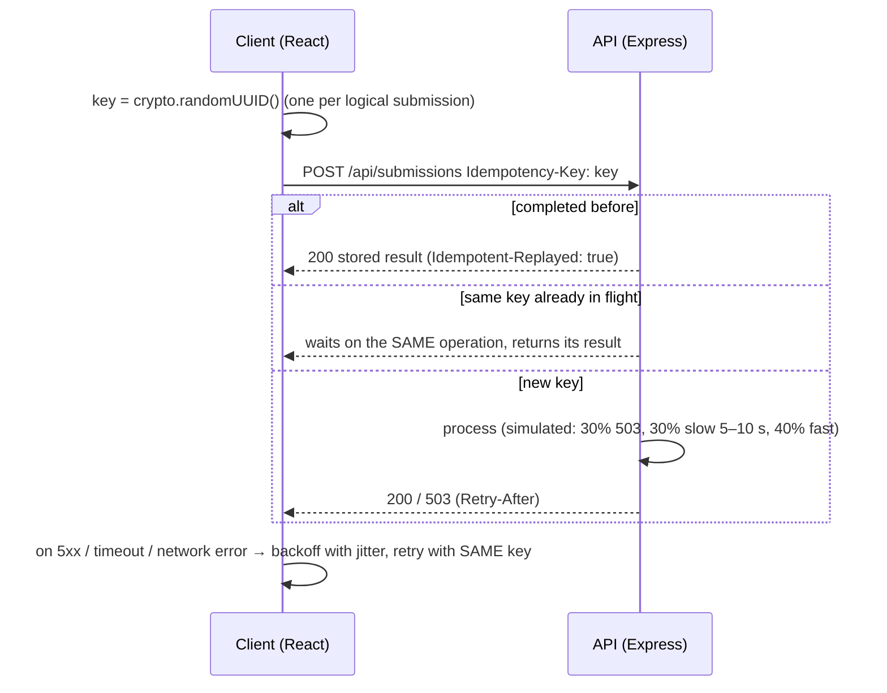

# Eventually Consistent Form

[](https://github.com/akhilreddy20/eventually-consistent-form/actions/workflows/ci.yml)

A small full-stack app (React + Express) that explores how to submit a form **exactly once** over an unreliable network, using **idempotency keys**, **retries with exponential backoff and jitter**, and an explicit client-side state machine.

**Live demo:** https://eventually-consistent-form-mocha.vercel.app · **API docs:** `/api-docs` (Swagger)

---

## The problem

When a client doesn't get a response, it can't tell whether the request failed or only the response was lost. Retrying is necessary, but a naive retry can **double-charge** or **double-submit**. This project makes retries safe.

## How it works



### Key design decisions

| Decision | Why | Trade-off |
|---|---|---|
| **Client-generated key, sent in the `Idempotency-Key` header** (body still accepted) | Same convention as Stripe's API. The client is the only party that knows two requests are the "same" operation. | The client must persist the key across reloads for full safety (not done here). |
| **In-flight de-duplication.** The key is registered *before* the first `await`, and concurrent callers share one promise. | Without it, a retry that arrives while the first attempt is still running passes the "seen?" check and creates a duplicate. That bug existed in v1 and is now covered by a 50-request concurrency test. | Single-process only (see Limitations). |
| **Request fingerprint (SHA-256 of the body)** | Reusing a key with a *different* body is a client bug; the server returns **422** instead of silently replaying the wrong result. | Field order must be stable when hashing. |
| **Failures don't poison the key** | A 503 attempt stores nothing, so the next retry with the same key gets a fresh attempt. | — |
| **Full-jitter backoff** (`random(0, min(cap, base·2^n))`) with `Retry-After` honoured | Avoids synchronized retry storms against a recovering server. | Slightly less predictable latency. |
| **Per-request timeout** (`AbortController`, 15 s) | Without it, "network timeout → retry" can never happen. | The timeout must exceed the slowest legitimate response. |
| **Retry only 408/429/5xx/network/timeout; never other 4xx** | Retrying a validation error can't succeed. | — |

### Client state machine

`idle → pending → (retrying ⟲) → success | error`. A ref guard ignores double-clicks while a submission is in flight, so one click equals one key.

## Running locally

```bash
# API
cd backend && npm ci && npm run dev          # http://localhost:3001  (docs at /api-docs)

# UI
cd frontend && npm ci && npm run dev         # http://localhost:5173
```

| Env var | Default | Purpose |
|---|---|---|
| `PORT` | `3001` | API port |
| `CORS_ORIGINS` | localhost + demo URL | Comma-separated allow-list |
| `SIMULATE_FAILURES` | `true` | Set `false` to turn off the random 503s and delays |
| `VITE_API_URL` | `http://localhost:3001` | API base URL for the UI |

Docker (API): `docker build -t ecf-api ./backend && docker run -p 3001:3001 ecf-api`

## Tests

```bash
cd backend && npm test     # node:test + fetch (no extra deps): idempotency, concurrency, validation, error mapping
cd frontend && npm test    # node:test: retry policy, same-key retries, timeouts, Retry-After, jitter bounds
```

Notable cases:
- **50 concurrent requests with one key → exactly one record** (regression test for the v1 race).
- Same key with a different body → 422.
- A 503 followed by a retry → one record, not zero or two.
- 4xx responses are never retried; timeouts and network errors are.

CI (GitHub Actions) runs lint, tests, the frontend build and a Docker build on every push and PR.

## Limitations, and what production would need

This is a learning project. The store is an **in-memory `Map`**, so:

1. **Durability:** a restart forgets every key, so a retry after a restart can duplicate. *Fix:* store keys in Postgres (`UNIQUE (key)`) or Redis (`SET key NX PX`) and save the response next to the key.
2. **Horizontal scaling:** two instances don't share in-flight state. *Fix:* the shared store's atomic insert becomes the lock. Insert `status = 'processing'` first, then update it to `complete` with the response.
3. **Key expiry:** keys are never evicted. *Fix:* a TTL (Stripe uses 24 h).
4. **Side effects:** a real handler that calls a payment provider should pass the same key downstream, or use an outbox table so the record and its side effect commit together.

## Project structure

```
backend/
  src/app.js                         Express app factory (testable, no listen)
  src/server.js                      entrypoint + graceful shutdown
  src/controllers/submissions.controller.js   validation + HTTP mapping + OpenAPI docs
  src/services/submissions.service.js         idempotency logic
  test/                              node:test suites
frontend/
  src/services/api.js                retry policy (timeout, jitter, Retry-After)
  src/hooks/useSubmission.js         state machine + double-submit guard
  test/                              node:test suites
```

## Author

**Akhil Reddy** · [GitHub](https://github.com/akhilreddy20) · [LinkedIn](https://linkedin.com/in/akhilreddy20)
